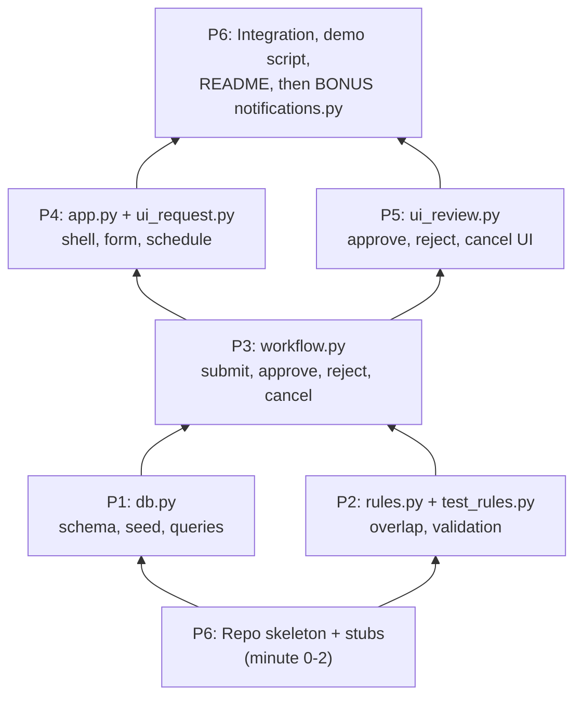

# Campus Event Management System: 15-Minute MVP

**Purpose:** the smallest build that still demonstrates the brief's full lifecycle (*request → review → confirmed/rejected → cancel → venue released*) and meets all 10 business conditions.
**Cut from:** [user-stories.md](user-stories.md) (full backlog: 38 stories). Anything not listed here is deferred, not dropped.

---

## 1. Cut-Down Principles

1. **Keep what an evaluator checks:** the end-to-end flow, conflict prevention, capacity, maintenance blocks, release on reject and cancel, clear reasons.
2. **Cut anything that adds screens, states or configuration** without proving a business condition.
3. **Seed data does the work of admin screens:** the renovation block and confirmed events come from the brief, so no block-management UI is needed to satisfy condition 4.
4. **No past-date validation in the MVP.** It avoids the demo-clock problem (seed data is dated Aug 2026 and today is past that) at zero cost. Documented as an assumption.

---

## 2. MVP Stories (6)

| # | Story | Merges (from backlog) | Time |
|---|---|---|---|
| **MVP-1** | Seeded DB + role switcher | US-01, US-03, US-34, US-36 (simplified), TS-01 | 2 min |
| **MVP-2** | Submit a request with all validations | US-06 – US-12 | 5 min |
| **MVP-3** | Venue schedule / all-events view | US-04, US-23 | 2 min |
| **MVP-4** | Approve or reject with a reason | US-17, US-18, US-19 | 3 min |
| **MVP-5** | Cancel a confirmed event | US-24 | 1 min |
| **MVP-6** | Overlap rule tests | TS-02 (minimal) | 2 min |
| | | **Total** | **15 min** |

### MVP-1: Seeded database and role switcher
**As a** demo operator, **I want** the app to start with the brief's venues and bookings and let me switch roles, **so that** I can show every persona without login.

- On first run, the SQLite DB is created and seeded: 5 venues, the 2 confirmed events, and the Conference Room C renovation block (4 Aug 09:00–18:00).
- The sidebar has a role selector: **Requester** / **Reviewer**.
- A **"Reset demo data"** button deletes the DB file and re-seeds it.

### MVP-2: Submit an event request with validations
**As a** requester, **I want** to submit a request and be stopped with a clear reason if it can't be satisfied, **so that** no venue is double-booked or overfilled.

Form fields: title, event type, venue, start date-time, end date-time, expected attendance.

| Check | Example | Message |
|---|---|---|
| End after start | 12:00 → 10:00 | "End time must be after start time" |
| Attendance ≤ capacity | Innovation Lab, 80 | "Expected attendance 80 exceeds Innovation Lab capacity of 60" |
| No overlap with a **Pending or Confirmed** event | Seminar Hall A, 4 Aug 11:00–13:00 | "Conflicts with confirmed event on 4 Aug 2026 10:00–12:00" |
| No overlap with a **block** | Conference Room C, 4 Aug 14:00–15:00 | "Venue unavailable (Renovation) 4 Aug 2026 09:00–18:00" |
| Back-to-back allowed | Seminar Hall A, 4 Aug 12:00–13:00 | Accepted |

- A valid request is saved as **Pending** and holds the venue.
- All failures are shown together; nothing is saved on failure.

### MVP-3: View schedule and statuses
**As a** requester or reviewer, **I want** one table of all events with venue, time and status, **so that** I can see what's booked and track my requests.

- Shows every event and block, filterable by venue.
- Statuses: Pending / Confirmed / Rejected / Cancelled, plus Blocked.

### MVP-4: Approve or reject
**As a** reviewer, **I want** to approve or reject pending requests, **so that** only reviewed requests become confirmed events.

- Visible only in the **Reviewer** role.
- **Approve** → Confirmed. The overlap check is re-run first.
- **Reject** → requires a reason → Rejected (closed). The slot is **free immediately**.

### MVP-5: Cancel a confirmed event
**As a** requester or reviewer, **I want** to cancel a confirmed event, **so that** the venue is released.

- A Cancel button on Confirmed events, with a required reason → Cancelled. The slot is **free immediately**.

### MVP-6: Overlap rule tests
**As a** developer, **I want** a few automated checks on the conflict rule, **so that** the core business rule is proven.

- Tests: overlap, fully contains, adjacent (allowed), different venue (allowed), and rejected/cancelled events don't block.

---

## 3. Bonus: In-App Notifications

**Chosen because:** it directly answers the brief's "limited visibility into request status" pain point, needs only one table and a few lines on existing actions, and is clearly visible in a demo. The alternatives (maintenance-block UI with cascade, analytics dashboard) each need a new screen and more logic.

**BONUS-1: Notify the requester of decisions** (≈ 5 min, only after MVP-1 to MVP-5 work end to end)
**As a** requester, **I want** a notification when my request is approved, rejected or cancelled, **so that** I don't have to keep checking.

- Approve, reject and cancel each write a notification row: event title, new status, reason.
- The sidebar shows the notification list (newest first) with an unread count.
- "Mark all read" clears the count.

*Fallback bonus (if notifications are done early):* show a venue utilisation summary (confirmed hours per venue) on the schedule page.

---

## 4. Compressed Architecture

The 4-layer structure in [architecture.md](architecture.md) is the **target**. For 15 minutes with 6 people, collapse it to **one file per owner**, keeping the same separation: UI, rules and DB never mix, and no two people edit the same file.

```
campus-event-management/
├── app.py              # Streamlit shell: page setup, sidebar role switcher, reset button, layout
├── ui_request.py       # request form + schedule table (MVP-2 UI, MVP-3)
├── ui_review.py        # reviewer queue: approve/reject; cancel buttons (MVP-4, MVP-5 UI)
├── workflow.py         # use cases: submit, approve, reject, cancel (calls rules + db)
├── rules.py            # pure business rules: overlap, validation → list of reasons
├── db.py               # SQLite: schema, seed data, query/update functions
├── notifications.py    # BONUS: own table + notify / list / mark-read
├── test_rules.py       # MVP-6 tests (pytest)
├── requirements.txt    # streamlit, pytest
├── README.md           # run steps, assumptions, scope, exclusions
└── var/                # campus_events.db (git-ignored)
```

| File | Why it exists |
|---|---|
| `app.py` | Single Streamlit entry point. Holds only the shell, and calls `ui_*` functions for each section. |
| `ui_request.py`, `ui_review.py` | Split by persona so two people can build screens in parallel. Display only; they call `workflow.py`. |
| `workflow.py` | The only place where state changes happen: it combines rules and DB calls. Grows into `cems/services/`. |
| `rules.py` | The only file that decides what's allowed. Pure Python, so it can be tested and explained alone. Grows into `cems/domain/`. |
| `db.py` | The only file that imports `sqlite3`. Grows into `cems/data/`. |
| `notifications.py` | The bonus is isolated, so it can be dropped or added without touching core files beyond one call per action. |
| `test_rules.py` | Proves the core rule; that's evidence for the "testing performed" part of the demo. |

**Data model (2 tables + 1 bonus)**

- `venues` (id, name, type, capacity)
- `events` (id, title, event_type, venue_id, start_at, end_at, attendance, status, reason). Blocks are stored here too, with `status = 'BLOCKED'`. That makes one overlap query cover both conditions 2 and 4.
- *Bonus:* `notifications` (id, event_id, message, is_read, created_at)

**Holding statuses:** `PENDING`, `CONFIRMED`, `BLOCKED`. Venue release on reject or cancel is automatic because availability is computed from status.

---

## 5. Deferred to Next Steps (from the full backlog)

| Deferred | Reason |
|---|---|
| Block-management UI + cascade (US-28 – US-31) | The seeded block already proves condition 4 |
| Withdraw pending (US-26) | Not required by the brief |
| Demo clock, past-date check (US-35, US-11 partial) | Removed with the past-date rule |
| Multiple users, ownership, self-approval prevention (US-02, US-20) | A role switcher is enough to show "appropriate user" |
| Suitability warnings, pending cap (US-14, US-15) | Not a brief condition |
| Audit history (US-27, US-32, US-33) | Status + reason on the record is enough for the MVP |
| Concurrency guarantee (US-16) | A single local user in the demo |
| Pre-submit availability panel (US-05) | The schedule table on the same page covers it |

---

## 6. Condition Coverage Check

| Brief condition | Covered by |
|---|---|
| 1 Start, end, venue | MVP-2 |
| 2 No overlapping active/confirmed | MVP-2, MVP-6 |
| 3 Prevented before submission | MVP-2 |
| 4 Maintenance unavailability | Seeded block + MVP-2 |
| 5 Review before confirmation | MVP-4 |
| 6 Reject closes and releases | MVP-4 |
| 7 Appropriate user cancels | MVP-5 + role switcher |
| 8 Cancel releases | MVP-5 |
| 9 No partial/split/suggestions | Not built (by design) |
| 10 Clear reason when not satisfiable | MVP-2 |

**Demo script (2 minutes):** Seminar Hall A 11:00–13:00 → conflict refused → Innovation Lab 80 people → capacity refused → Conference Room C → renovation refused → Main Auditorium 300 → Pending → switch to Reviewer → Approve → cancel the seeded Seminar Hall A event → resubmit 11:00–13:00 → accepted.

---

## 7. Team Assignment (6 people)

Work is split by **development dependency**: the people at the bottom of the stack (data, rules) can't be blocked by anyone, and the people above them start straight away against **agreed function signatures** (Section 7.2) with stubs.

### 7.1 Dependency Graph



### 7.2 Interface Contract (agreed at minute 0, before anyone writes code)

Everyone codes against these names. The real implementations replace the stubs; signatures don't change without telling the people who depend on them.

| Owner | File | Functions exposed | Used by |
|---|---|---|---|
| P1 | `db.py` | `init_db(reset=False)`, `list_venues()`, `get_venue(venue_id)`, `list_events(venue_id=None)`, `find_overlaps(venue_id, start, end, exclude_id=None)` (returns PENDING / CONFIRMED / BLOCKED rows only), `insert_event(...)`, `update_status(event_id, status, reason)`, `get_event(event_id)` | P3, P4 (list functions only) |
| P2 | `rules.py` | `overlaps(a_start, a_end, b_start, b_end)`, `validate_request(venue, start, end, attendance, conflicts)` (returns a list of reason strings; empty means valid), `can_transition(from_status, action)` | P3, P2's tests |
| P3 | `workflow.py` | `submit_request(form) → (ok, reasons, event_id)`, `approve(event_id) → (ok, reasons)`, `reject(event_id, reason) → (ok, reasons)`, `cancel(event_id, reason) → (ok, reasons)` | P4, P5 |
| P4 | `app.py` / `ui_request.py` | `render_request_form()`, `render_schedule()` | `app.py` |
| P5 | `ui_review.py` | `render_review_queue()`, `render_cancel_panel()` | `app.py` |
| P6 | `notifications.py` | `notify(event_id, message)`, `list_notifications()`, `mark_all_read()` | P3 (one call per action), P4 (sidebar) |

Conventions: date-times are ISO strings `YYYY-MM-DDTHH:MM`; statuses are uppercase strings `PENDING`, `CONFIRMED`, `REJECTED`, `CANCELLED`, `BLOCKED`.

### 7.3 Assignments

| Person | Role | Owns | Stories | Depends on | Done when |
|---|---|---|---|---|---|
| **P1** | Data engineer | `db.py` | MVP-1 (data and seed half) | P6 skeleton only | `init_db()` creates and seeds 5 venues, 2 confirmed events and 1 block; `find_overlaps()` returns the Seminar Hall A event for 4 Aug 11:00–13:00 |
| **P2** | Business rules | `rules.py`, `test_rules.py` | MVP-2 (rules half), MVP-6 | Nothing (pure Python) | `pytest` passes: overlap, contains, adjacent allowed, capacity exceeded, end before start |
| **P3** | Workflow / integration of logic | `workflow.py` | MVP-2 (save), MVP-4 & MVP-5 (logic) | P1 + P2 signatures (stubs until merged) | submit → approve → cancel works from a Python shell; reject and cancel free the slot |
| **P4** | UI: shell + requester | `app.py`, `ui_request.py` | MVP-1 (role switcher, reset), MVP-2 (form), MVP-3 | P3 signatures (stub results until merged) | The form shows success or a list of reasons; the schedule table filters by venue |
| **P5** | UI: reviewer | `ui_review.py` | MVP-4 & MVP-5 (screens) | P3 signatures | Pending list with Approve/Reject (reason required); Cancel with reason on Confirmed events; visible to the Reviewer role |
| **P6** | Integrator / QA / docs + bonus | Repo skeleton, `requirements.txt`, `.gitignore`, `README.md`, `notifications.py` | TS-01, TS-04, demo script, **BONUS-1** | Everyone (integration); nothing for the skeleton | Minute 2: skeleton pushed. Minute 12: demo script passes end to end. Then: the bonus works |

### 7.4 Timeline

| Minute | P1 | P2 | P3 | P4 | P5 | P6 |
|---|---|---|---|---|---|---|
| 0–2 | Agree the contract (all) | ← | ← | ← | ← | Push the skeleton with stub files |
| 2–8 | Schema + seed + queries | Rules + tests | Workflow against stubs | Shell + form + schedule against stubs | Review/cancel UI against stubs | README (run steps, assumptions, scope) |
| 8–9 | **Merge** `db.py` | **Merge** `rules.py` | | | | Watches merges, runs `pytest` |
| 9–11 | Help P3 debug queries | Help P3 with reasons text | **Merge** `workflow.py` (real calls) | Wire to the real workflow | Wire to the real workflow | |
| 11–12 | | | | **Merge** UI | **Merge** UI | Pull and run the app |
| 12–15 | Fix bugs found | Fix bugs found | Fix bugs found | Fix bugs found | Fix bugs found | **Run the demo script**; log failures to owners |
| 15+ | | | Add `notify()` calls | Sidebar notification list | | **BONUS:** `notifications.py` |

### 7.5 Collaboration Rules

1. **One file, one owner.** Nobody edits another person's file. Ask the owner, which keeps merge conflicts close to zero.
2. **Stubs first.** P6's skeleton contains every file with the agreed functions returning dummy values, so the app runs from minute 2.
3. **Merge order follows dependencies:** P1/P2 → P3 → P4/P5 → bonus.
4. **Small commits naming the story:** e.g. `MVP-2: reject overlapping requests`. This is evidence of individual contribution in the git history.
5. **Pull before every push;** `pytest` must pass before merging rules or workflow.
6. **Each person prepares one explanation** for the demo Q&A: P1 the data model, P2 the overlap rule, P3 the state transitions, P4 the requester flow, P5 the review flow, P6 the testing and assumptions.
7. **AI agents follow [AGENTS.md](../AGENTS.md)** (loaded automatically by Claude Code via `CLAUDE.md` and by Copilot via `.github/copilot-instructions.md`). It enforces file ownership, the interface contract and the MVP scope for every teammate's agent.
