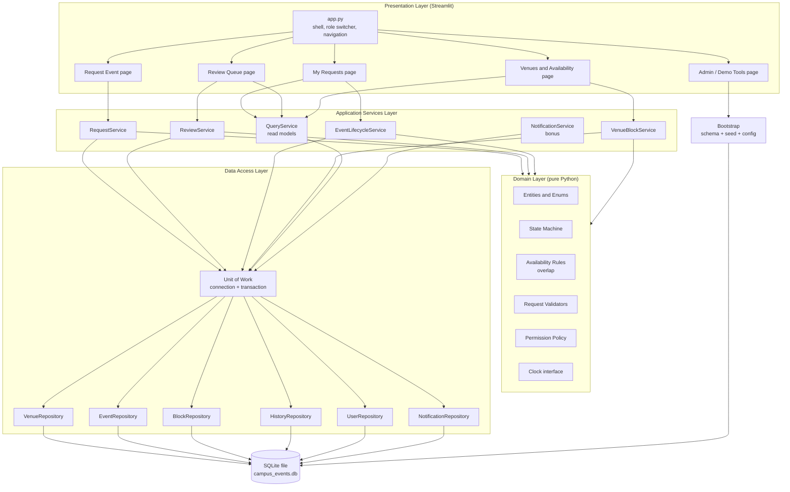
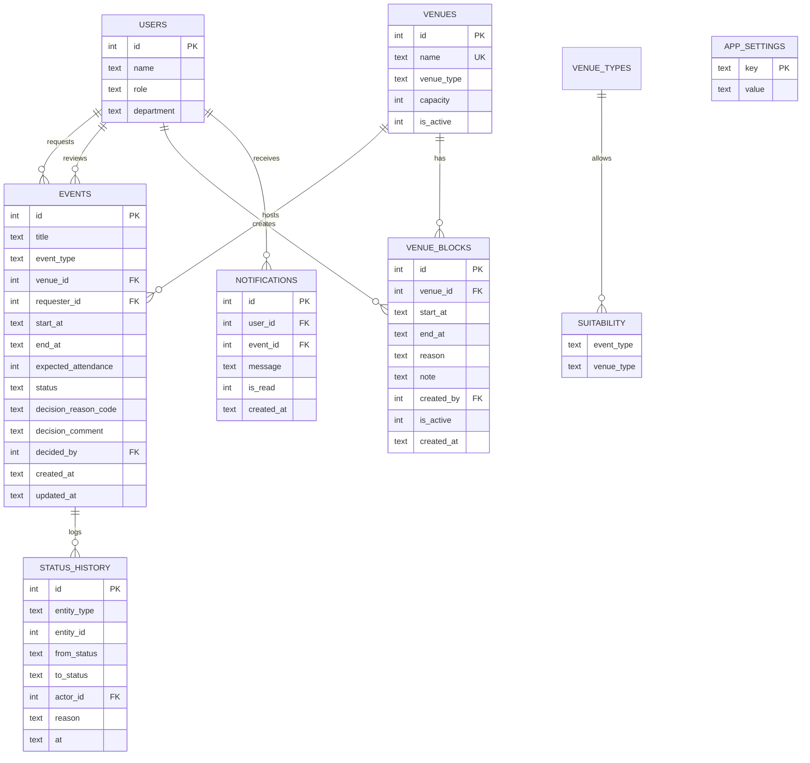
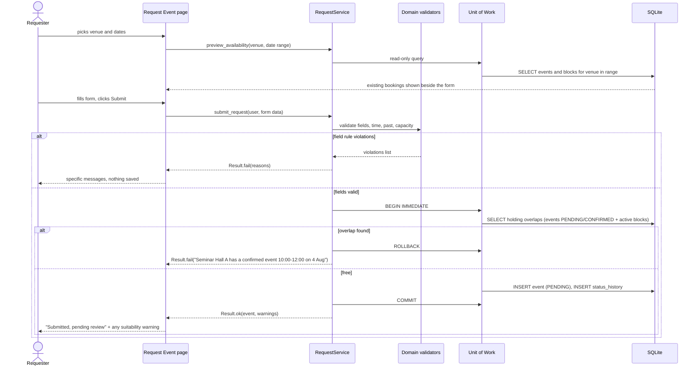

# Campus Event Management System: Solution Design

**Stack:** Python 3.11+ · Streamlit · SQLite (standard-library `sqlite3`)
**Inputs:** [requirements-analysis.md](requirements-analysis.md), revised by [critical-review.md](critical-review.md). This design applies the review's corrections (demo clock, multi-day events, maintenance cascade, type-suitability as a warning, no `Draft` state, reduced scope).
**Status:** design only. No code yet.

---

## 1. Design Goals and Principles

| Principle | What it means here |
|---|---|
| **Business rules live in one place** | All rules (overlap, capacity, state transitions) sit in a pure-Python domain layer with no Streamlit or SQLite imports. The UI never decides whether something is allowed. |
| **One availability check, used everywhere** | Submit, approve and block creation all call the same availability function. This removes the risk of validation copies drifting apart (review F4). |
| **Availability is derived, not stored** | There's no separate "venue booked" flag to keep in sync. A venue is committed if a *holding* record overlaps the interval. Rejecting or cancelling just changes the status, so release is automatic and can't be forgotten (conditions 6 and 8). |
| **Check-and-write inside one transaction** | Prevents two users winning the same slot (edge case E15). |
| **Layered, with dependencies pointing inward** | UI → Services → Domain ← Repositories. The domain depends on nothing. |
| **Explicit over clever** | Small modules, each with one owner on the team, each explainable in two minutes (review F5). |
| **Injected clock** | "Now" comes from a configurable clock, so the August 2026 seed data stays valid for demos and tests (review H1). |

---

## 2. Architecture Overview



**Dependency rule:** a layer may call only the layer directly below it, and the domain layer imports nothing from the others. Pages never import repositories or `sqlite3`.

---

## 3. Major Components and Responsibilities

### 3.1 Presentation Layer (Streamlit)

| Component | Responsibility | Does NOT do |
|---|---|---|
| **App shell** (`app.py`) | Page config; bootstraps the DB on first run; **role/user switcher** in the sidebar (stands in for authentication, see A14); shows the current demo date; navigation. | Business logic, SQL |
| **Request Event page** | Form for title, event type, organizer, venue, start/end date-time, attendance. Shows the selected venue's **existing bookings and blocks for the chosen dates while the form is filled in** (review BR2). On submit, calls `RequestService` and shows either success or a list of **specific reasons**. | Decide validity |
| **My Requests page** | The current user's requests and events, with status, reasons and history. Buttons: **Withdraw** (Pending) and **Cancel** (Confirmed), shown only when the permission policy allows. | |
| **Review Queue page** (Reviewer) | Pending requests ordered by start time, with capacity fit and **suitability warnings**. **Approve** / **Reject** with a mandatory reason code and comment. | |
| **Venues & Availability page** | Venue catalogue; day/week view per venue (confirmed, pending, blocked). For the Facilities role: **create a block**, with a preview of the bookings that would be cascade-cancelled and a confirmation step. | |
| **Admin / Demo Tools page** | **Reset demo data**, set the **demo clock**, view the audit log. | |
| **UI helpers** | Formatting (dates, status badges), turning domain error codes into readable messages. | |

**Streamlit-specific rules**

- Every write action goes through `st.form` or a button guarded by a state check, so a rerun or double-click can't submit twice (E13). The service rejects the second attempt anyway.
- `st.session_state` holds **only UI state**: the current user, selected filters and the last result message. Business data is always re-read from the DB on each rerun, so the screen can't show stale state (E14).
- After a successful write, the page stores a flash message in `session_state` and calls `st.rerun()` so every panel refreshes from the DB.

### 3.2 Application Services Layer

Services are the **use cases**. Each public method is one business operation and one transaction. They coordinate domain rules and repositories, and return a **Result** object (success + data, or failure + a list of reasons). They don't raise exceptions to the UI for expected business failures.

| Service | Operations | Responsibility |
|---|---|---|
| **RequestService** | `submit_request`, `withdraw_request`, `preview_availability` | Validates input, checks availability and capacity, creates a `PENDING` record, writes history. Enforces the open-pending cap per requester. |
| **ReviewService** | `approve`, `reject` | Checks permissions (Reviewer, not their own request: BR1); **re-checks availability and start-not-passed** at approval (FR-15, E11); moves to `CONFIRMED` or `REJECTED`; records the reason. |
| **EventLifecycleService** | `cancel_event` | Checks permissions (owner or Reviewer: A4); rejects past events (BR9); moves to `CANCELLED`; records the reason. |
| **VenueBlockService** | `preview_block_impact`, `create_block`, `release_block` | Validates the interval; finds overlapping holding events; on confirmation, creates the block **and cascade-cancels the affected events in the same transaction** with reason `VENUE_UNAVAILABLE` (review H3). |
| **QueryService** | `venue_schedule`, `my_requests`, `pending_queue`, `event_history`, `audit_log` | Read-only views shaped for the UI. No state changes. Keeps read SQL out of the write services. |
| **NotificationService** *(bonus)* | `notify`, `unread_for_user`, `mark_read` | Writes in-app notifications when someone else acts on a user's booking (approve, reject, cancel, cascade). Called inside the same transaction as the triggering change. |

### 3.3 Domain Layer (pure Python, no I/O)

| Component | Responsibility |
|---|---|
| **Entities & value objects** | `Venue`, `EventRequest` (one entity across its whole lifecycle), `VenueBlock`, `User`, `TimeSlot(start, end)`. Uses dataclasses; `TimeSlot` validates `end > start` and a maximum duration when created. |
| **Enums** | `EventStatus` {PENDING, CONFIRMED, REJECTED, WITHDRAWN, CANCELLED}; `Role` {REQUESTER, REVIEWER, FACILITIES, ADMIN}; `EventType`; `VenueType`; `BlockReason` {MAINTENANCE, RENOVATION, OTHER}; `ReasonCode`. |
| **State machine** | One table of allowed transitions, `{(from_status, action): to_status}`. Every status change goes through it, so invalid transitions are impossible by construction (FR-20, E16). It also defines `HOLDING_STATUSES = {PENDING, CONFIRMED}`. |
| **Availability rules** | `overlaps(a, b)` using half-open intervals: `a.start < b.end and b.start < a.end` (A2; covers E1–E5). A buffer parameter defaults to 0, so a customer-requested changeover time is a configuration change. |
| **Request validators** | Each rule is a small function returning `None` or a `Violation(code, message)`: time sanity, not in the past (via the Clock), attendance > 0, attendance ≤ capacity, venue active. **Suitability** returns a `Warning`, not a `Violation` (review H4). Running all of them collects **every** reason, so the requester sees all the problems at once. |
| **Permission policy** | `can(user, action, event)`: who may submit, withdraw, approve, reject, cancel, block. Kept in one place so roles are easy to explain and change. |
| **Clock** | An interface with `now()`. `SystemClock` returns real time; `FixedClock` returns the configured demo date. Injected into services. |

### 3.4 Data Access Layer

| Component | Responsibility |
|---|---|
| **Unit of Work** | Opens a SQLite connection; sets `PRAGMA foreign_keys=ON` and `journal_mode=WAL`; starts the write transaction with `BEGIN IMMEDIATE` so concurrent writers queue instead of racing (E15); commits on success, rolls back on any error; closes the connection. One unit of work per service call. |
| **Repositories** | One per table group. Translate between database rows and domain entities. Contain **all SQL**, always parameterised (no string formatting, so no SQL injection). Key query: `find_holding_overlaps(venue_id, slot, exclude_id)` returns conflicting events and blocks. |
| **Bootstrap** | Creates the schema if it's missing (idempotent); seeds the venues, users, confirmed events and renovation block from the brief; **runs the seed events through the same validators** (E23); handles a missing or corrupt DB by re-seeding with a warning (E24). |
| **Config** | DB path, demo clock date, max duration, max open pending per user, buffer minutes. One module, read once. |

---

## 4. Data Model (SQLite)

Times are stored as **ISO-8601 text, local campus time, minute precision** (`YYYY-MM-DDTHH:MM`). Strings in that format sort the same way as the times they represent, so overlap checks work directly in SQL, and there's no timezone-aware/naive mixing (E8, E9).



**Key design choices**

- **One `events` table for requests and events.** A "request" and a "confirmed event" are the same record at different statuses. That avoids copying data on approval and keeps history in one place.
- **Database-level safety nets:** `CHECK (end_at > start_at)`, `CHECK (expected_attendance > 0)`, `CHECK (status IN (...))`, foreign keys, `UNIQUE(venue.name)`. These back up the domain rules; they don't replace them.
- **Index** on `events(venue_id, status, start_at, end_at)` and `venue_blocks(venue_id, start_at, end_at)`, used by the overlap query.
- **No overlap constraint in the DB.** SQLite can't enforce interval exclusion. It's guaranteed by *check + insert inside one `BEGIN IMMEDIATE` transaction*.
- **`status_history`** covers both events and blocks (`entity_type`), closing review gap BR11.
- **`app_settings`** stores the demo clock, so it survives restarts and is shared by all browser tabs.
- **Stale pending requests:** a Pending request whose start has passed can't conflict with any new request, because new requests must be in the future. So stale holds need no background job. Only approval checks `start > now` (A11, without a scheduler).

---

## 5. How Data Flows Through the System

### 5.1 Submit Event Request (core flow, conditions 1, 2, 3, 4, 10)



### 5.2 Review: Approve or Reject (conditions 5 and 6)

1. The Reviewer opens the queue → `QueryService.pending_queue()` → SELECT Pending, ordered by start.
2. **Approve** → `ReviewService.approve(reviewer, id)`:
   - **Permission:** the user is a Reviewer and not the requester.
   - **BEGIN IMMEDIATE** → reload the event → **state machine:** PENDING→CONFIRMED is allowed → **start > now** → **re-run the overlap check, excluding itself** (catches a block added meanwhile).
   - UPDATE status, decided_by, decision; INSERT history; INSERT notification → **COMMIT**.
3. **Reject** → same steps, but a reason is mandatory and there's no overlap check. Status becomes **REJECTED**. Because REJECTED isn't a holding status, the slot is **free as soon as the transaction commits**. Nothing else needs updating.

### 5.3 Cancel Confirmed Event (conditions 7 and 8)

`EventLifecycleService.cancel_event(user, id, reason)` → permission (owner or Reviewer) → not past → state machine CONFIRMED→CANCELLED → UPDATE + history + notification (when cancelled by someone other than the requester) → COMMIT. The venue is free immediately because availability is derived.

### 5.4 Create Maintenance Block with Cascade (condition 4, review H3)

1. The Facilities user enters venue, interval and reason → `preview_block_impact()` returns the holding events that would be affected → the UI lists them and asks for confirmation.
2. On confirmation → `create_block()` in **one transaction**: INSERT block → for each affected event, state machine → CANCELLED with reason `VENUE_UNAVAILABLE` → history + notification for each → COMMIT. Either all of it happens or none of it does.

### 5.5 Read Flows

Every page render runs fresh `QueryService` reads through a short-lived read-only connection. Nothing business-related is cached between reruns, so what the user sees always matches the DB.

---

## 6. How the UI Interacts with the Database

```
 Streamlit page ──calls──► Service method ──opens──► Unit of Work ──uses──► Repositories ──SQL──► SQLite
      ▲                         │                                                              │
      └──── Result (ok/fail, ◄──┘◄──────────────── domain entities ◄──────── rows ◄────────────┘
            reasons, warnings)
```

| Rule | Reason |
|---|---|
| **The UI never touches SQLite.** Pages import services only. | The UI can be swapped (e.g. Flask later) without touching rules; there's one path for writes. |
| **One connection per service call**, opened and closed by the Unit of Work. No connection is cached in `st.cache_resource`. | Streamlit runs scripts on different threads, and `sqlite3` connections are thread-bound by default. Short-lived connections avoid `check_same_thread` errors and lock leaks. SQLite opens connections in microseconds. |
| **Writes use `BEGIN IMMEDIATE`; reads use plain connections**, with WAL mode on. | WAL lets readers keep working while a write happens; IMMEDIATE queues writers, so check-then-insert is safe. |
| **Services return `Result` objects** with machine codes plus human messages. | The UI renders reasons without parsing exceptions; tests assert on codes, not wording. |
| **Unexpected errors** (DB locked, corrupt file) are caught at the page boundary, logged, and shown as a generic "Something went wrong, try again" message. | The demo never shows a stack trace. |
| **Bootstrap runs once per process** (guarded with `st.cache_resource` on the *init function*, not the connection). | Idempotent schema creation and seeding on first launch. |

---

## 7. Proposed Project Structure

Superseded by [architecture.md](architecture.md). That document has the full folder tree and the reason each folder exists.

---

## 8. Quality, Testing and Engineering Practices

| Area | Approach |
|---|---|
| **Unit tests (domain)** | Overlap: E1–E8 (duplicate, contains, inside, adjacent, block-adjacent, zero-length, midnight). Validators: E18, E19, past, max duration. State machine: every allowed and forbidden transition. Permissions: BR1, A4. No DB needed, so they run in milliseconds. **Written first** (review F8). |
| **Service tests** | Each runs against a fresh temporary SQLite file with a `FixedClock`. Cover: submit → conflict; submit → approve → cancel → resubmit succeeds (release); reject releases; block cascade; approve after start blocked; double-approve fails cleanly; two submits of the same slot, only one succeeds. |
| **Seed test** | The seed data loads and passes all validators (E23). |
| **Manual demo script** | The six scenarios from the requirements doc, run with the demo clock set to 1 Aug 2026. Reset before every rehearsal. |
| **Code practices** | Type hints throughout; dataclasses; no global mutable state; parameterised SQL only; constants and config in one module; small functions; a docstring on every public service method naming the business rule it enforces. |
| **Error handling** | Expected business failures → `Result.fail`. Unexpected failures → logged with context, generic UI message, transaction rolled back. |
| **Logging** | Standard `logging` to the console: one line per service call (operation, user, outcome). |
| **Git workflow** | Short-lived feature branches per module, small commits, merge to `main` often. One owner per folder to avoid conflicts (Section 10). |

---

## 9. Traceability: Brief Conditions → Design

| Brief condition | Where it is satisfied |
|---|---|
| 1. Event has start, end, venue | `events` schema + `TimeSlot` value object + DB CHECK |
| 2. No overlapping active requests or confirmed events | `availability.overlaps` + `HOLDING_STATUSES` + `find_holding_overlaps` inside `BEGIN IMMEDIATE` |
| 3. Conflict prevented before submission | `RequestService.submit_request` checks before INSERT; live availability preview on the form |
| 4. Venue unavailable (maintenance etc.) | `venue_blocks` table, included in the overlap query; `VenueBlockService` with cascade |
| 5. Review before confirmation | State machine allows only PENDING→CONFIRMED via `ReviewService.approve` |
| 6. Reject closes and releases; revise = new request | REJECTED is terminal and non-holding; no edit operation exists |
| 7. Appropriate user can cancel | `permissions.can(user, CANCEL, event)` → owner or Reviewer |
| 8. Cancel releases venue | CANCELLED is non-holding; release is derived |
| 9. No partial/split bookings or suggestions | One venue per event; no suggestion component (documented exclusion) |
| 10. Unsatisfiable request is stopped with a clear reason | Validators return coded violations → readable messages; all reasons shown together |

---

## 10. Build Plan and Team Ownership (90 minutes)

| Owner | Module | Done when |
|---|---|---|
| Member 1 | `domain/` + domain tests | The overlap, validator and state-machine tests pass |
| Member 2 | `data/` (schema, seed, repositories, Unit of Work) | The seed loads; the overlap query returns the seeded conflicts |
| Member 3 | `services/` + service tests | The submit → approve → cancel → resubmit flow passes |
| Member 4 | `app.py`, `pages/`, `ui/` + README and pitch | The end-to-end demo runs in the browser |

**Integration order:** domain (no dependencies) → data → services → UI. The UI can start straight away against stubbed service results, because the service method signatures are agreed in this document.

**Milestones:** about 30 minutes in, domain and data merged; about 55 minutes, services merged and the end-to-end flow works; about 70 minutes, all scenarios rehearsed and the README done; any time left goes to the bonus (the notification feed).

---

## 11. Trade-offs and Known Limitations

| Decision | Trade-off accepted |
|---|---|
| Role switcher instead of authentication | Fast to build and easy to demo; segregation of duties is checked by user ID but isn't secure. |
| Availability derived from status | Release can't be forgotten, at the cost of an overlap query on every check. That's negligible at campus scale with an index. |
| A single `events` table across the lifecycle | Simple and auditable; a future "amend without losing the hold" feature would need a versioning design. |
| SQLite with `BEGIN IMMEDIATE` | Correct for a local prototype with a handful of users; not built for many concurrent writers or a multi-server setup. |
| Lazy handling of stale pending requests | No background scheduler (not allowed by the brief); stale requests sit visibly in the queue until someone rejects them. |
| Suitability as a warning only | Avoids rejecting valid requests on invented rules; it relies on reviewer judgement. |
| Streamlit | Quick to build a working UI; limited control over layout, and the rerun model needs the double-submit guards described above. |

**Excluded:** real authentication, email/SMS, alternative venue suggestions, partial or split bookings, recurring events, editing requests, multi-level approval, analytics dashboards, cloud deployment.

**Open dependencies:** the design assumes the defaults in the critical review until the customer answers the ★ questions (demo clock, overnight events, maintenance cascade, suitability as a hard rule or a warning).
